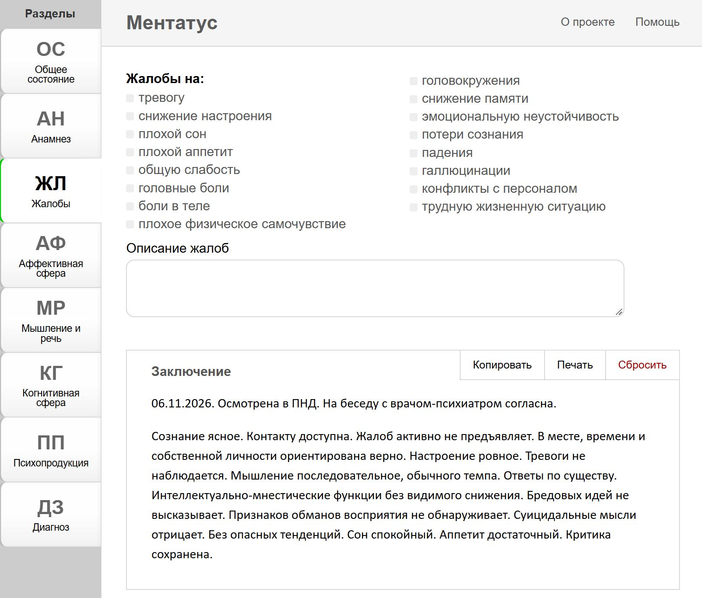

# Mentatus

[English](README.md) | **Русский**

Приложение для автоматизированного написания психиатрического статуса: слева —
разделы осмотра, в центре — форма раздела, справа собирается текст заключения
(его можно скопировать или распечатать).



## Стек

- React 18, react-redux 9, Redux Toolkit 2, `redux-persist` 6
- TypeScript (Vite, `moduleResolution: "Bundler"`)
- Vite 6 (сборка и dev-сервер), Vitest 5 + jsdom 30 (тесты)
- CSS без препроцессоров, иконки и манифест — в `public/`

## Быстрый старт

Нужен Node.js 24+ (проект проверен на Node 24.21 и npm 11.19).

```bash
npm ci
npm run dev        # http://localhost:5173
```

## Скрипты

| Скрипт | Что делает |
|---|---|
| `npm run dev` / `npm start` | dev-сервер Vite |
| `npm run build` | production-сборка в `dist/` |
| `npm run preview` | локальный просмотр собранного `dist/` |
| `npm test` | один прогон всех тестов (`vitest run`) |
| `npm run test:watch` | тесты в watch-режиме |
| `npm run typecheck` | `tsc --noEmit` |
| `npm run lint` | ESLint 9 (плоский конфиг `eslint.config.mjs`) |
| `npm run format` | Prettier 3 по `src/**` |
| `npm run css:audit` | отчёт «определено / используется» по CSS-классам |

Перед коммитом: `npm run typecheck && npm run lint && npm test && npm run build`.

## Структура `src`

```
index.tsx                 вход: Provider + PersistGate + каркас страницы
configureStore.ts         RTK store + persistor (throttle 300 мс)
reducers/
  index.ts                корневой редьюсер (только срезы разделов)
  sections.ts             карта «раздел → начальные значения» + индекс fieldSections
  createSectionSlice.ts   фабрика среза раздела (RTK + Immer)
actions/fieldActions.ts   SET_SYMPTOM / SET_TEXT / SET_RADIO
store/
  *Data.ts                схема раздела: подписи, фразы, типы, группы (cicle)
  *Store.ts               начальные значения полей среза
  *Layout.ts              декларативная раскладка формы раздела
  schemas.ts              карта «срез → схема»
  persist.ts              конфиг redux-persist и очистка старого ключа
lib/
  text/                   сборка фраз заключения, работа с датами
  rules/                  бизнес-правила (например, пустая критика)
  layout/                 обход layout и условия видимости
  redux/                  чтение полей стора и сравнение props для connect
  schema/                 работа со схемами (поиск пункта радиогруппы по id)
components/
  <Раздел>Manager         форма раздела (обёртка над <Section>)
  <Раздел>List            часть заключения (через <FieldView>)
  Section/Field/Group/FieldView — примитивы схемного рендеринга
containers/App            раскладка рабочего экрана
types/                    типы состояния, схем, layout и пропсов
```

## Как это работает

- Поле стора живёт в срезе своего раздела: `state[section][field]` и имеет форму
  `{ isChecked }` (чекбокс), `{ number }` (радиогруппа) или `{ text }` (текст/дата).
- Схема раздела (`store/*Data.ts`) — единственный источник правды о полях; её
  полноту проверяет `src/store/schema.test.ts`.
- Форма раздела описывается раскладкой (`store/*Layout.ts`) и рендерится
  компонентом `Section`; нестандартные блоки подключаются как `custom`.
- Заключение собирается из `*List` и чистых функций `lib/text`, поэтому логику
  текста можно тестировать без React.
- В `localStorage` сохраняются только срезы разделов (`persist:mentatus`);
  запись троттлится, чтобы не сериализовать состояние на каждый символ.

## Тесты

```bash
npm test
```

Покрыты чистые функции (`lib/text`, `lib/rules`, `lib/layout`, `lib/schema`),
редьюсеры, persist, полнота схем и smoke-монтирование приложения. Окружение —
jsdom, глобальные `describe/it/expect/vi`, `src/setupTests.ts` подключает
`@testing-library/jest-dom`.

## Документация по рефакторингу

История этапов рефакторинга и критерии приёмки — в `specs/` (начните с
`specs/README.md`).

## Лицензия

Apache License 2.0, см. `LICENSE`.

